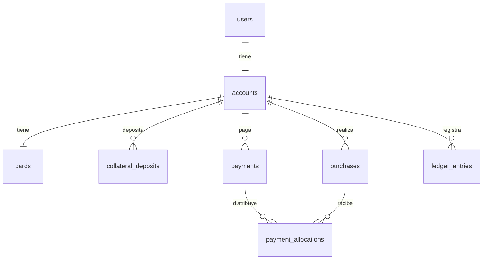

# Acme Credit — Infraestructura

Este documento describe la infraestructura propuesta para los distintos componentes del sistema, asumiendo un escenario real (no el de la prueba técnica), con foco en escalabilidad, seguridad y consistencia financiera.

Por cada componente se indica el enfoque **elegido** (el que se usaría pensando en escala real, ej. millones de usuarios) y, cuando aplica, una alternativa **simple** para contextos de menor escala o un MVP inicial.

Estructura del documento: **1. Frontend**, **2. Backend** (dividido en síncrono y asíncrono), **3. Base de datos**.

---

## 1. Frontend

### Login

Pantalla con el título "Acme Credit" y campos de usuario/contraseña. No valida nada real — cualquier valor ingresado inicia sesión (no hay auth, ver sección 4.4). No existe opción de crear cuenta: el único usuario (`users`) ya está pre-cargado en la base — **John Doe**, `john.doe@hotmail.com`.

Al hacer login, redirige a `/home`.

### Home

Muestra los datos del usuario (John Doe). El idioma de toda la UI es **inglés** (la documentación de este proyecto queda en español, pero las etiquetas/textos de la app son en inglés — ej. "Pending", "Available limit", "Pay").

**Si no tiene cuenta todavía**: se muestra una silueta de tarjeta punteada, en gris, con el texto "Create card" centrado. Al hacer hover se pone blanca. Al hacer click, abre el modal de "Crear tarjeta garantizada" (ver abajo).

**Si ya tiene cuenta**: en el mismo lugar de la silueta aparece la tarjeta real, con el estado que corresponda (`Pending`, `Active`, `Frozen`, `Cancelled`, `Overdue`/mora).

#### Diseño de la tarjeta

Paleta inspirada en el estilo de Nu — color principal **morado** (se indicará explícitamente en el frontend que es un estilo inspirado en esa paleta).

Layout dentro de la tarjeta:
- **Arriba-izquierda**: logo de Acme.
- **Arriba-derecha**: texto "Credit".
- **Justo debajo de "Credit" (arriba-derecha)**: bolita de color + texto del estado.
- **Abajo-derecha**: logo de Mastercard.
- **Abajo-izquierda**: solo cuando el estado es `Active` → título "Current debt" y el monto debajo.

Colores de la bolita de estado:

| Estado | Color |
|---|---|
| Pending | Amarillo |
| Active | Verde |
| Frozen | Celeste / gris azulado |
| Cancelled | Gris |
| Overdue (mora) | Rojo |

**Qué es `Overdue`**: el estado visual que se muestra cuando `payment_due_date` ya pasó sin que se haya pagado el mínimo. Es puramente informativo — no bloquea compras ni dispara ningún efecto de negocio (ver nota de alcance más abajo).

**Prioridad de la bolita de estado** (cuando más de una condición aplicaría a la vez): `Cancelled` > `Pending` > `Frozen` > `Overdue` > `Active`. Ej.: si la tarjeta está congelada por el usuario Y además `payment_due_date` ya pasó, se muestra `Frozen`, no `Overdue`.

#### Debajo de la tarjeta (solo visible cuando el estado es `Active`)

**Grid 2x2:**

| | |
|---|---|
| Available limit | Statement date |
| Minimum payment | Payment due date |

**Botón "Pay"**, con el color principal (morado).

**Lista de movimientos** (máximo 6, más reciente primero): cada ítem tiene, de izquierda a derecha:
1. Ícono circular con el **logo de Acme** (el mismo para todos los ítems, sea compra o pago — no hay logos de comercio reales).
2. Nombre del comercio (ej. "DECATHLON", ingresado al simular la compra; para pagos, un texto fijo como "Payment") y debajo la fecha (ej. "Mar 20 Oct 2026").
3. Monto alineado a la derecha (ej. "$ -445,983.17").

Debajo de la lista: botón "View all transactions".

#### Botón "Simulate purchase"

Botón "+" circular, con el color primary de fondo, posicionado **fixed**, a la derecha de la pantalla, centrado verticalmente. **Solo visible cuando la tarjeta está `Active`** (no tiene sentido simular un gasto si la cuenta está `Frozen`, `Pending`, `Cancelled` o `Overdue` — de hecho, estos estados son la oportunidad de mostrar la regla real de "no se puede comprar").

Al hundirlo, abre el modal **"Simulate purchase"**:
- Campo: nombre del comercio (ej. "DECATHLON") — texto libre, no hay comercios reales.
- Campo: monto.
- Campo: plan de cuotas — 4 opciones: **1, 3, 6 o 12 cuotas** (igual que `product.md`).
- Validación: el monto no puede exceder `available_credit_cents`.
- Al confirmar, crea una `purchase` real (autorizada contra el cupo disponible, con lock de fila — mismo mecanismo de concurrencia definido en la sección 3), que aparece inmediatamente en la lista de movimientos.

**Por qué está en la UI del cliente y no es solo un endpoint de prueba aparte**: en la vida real esto lo dispararía un comercio/POS, no el propio cliente — pero para este demo se expone como una acción explícita de "simular gasto" dentro de la misma app, dejando claro que es una simulación, sin pretender ser una integración de comercio real. Esto resuelve el requisito mínimo de `CHALLENGE.md` de autorizar compras contra el cupo disponible, de forma demostrable dentro de la misma interfaz.

**Alcance real de estos datos**: aunque los procesos de extractos/intereses/mora (sección 4.2) no se despliegan como jobs, los campos `Statement date`, `Minimum payment` y `Payment due date` sí se calculan con datos reales — con fórmulas puras, sin necesidad de ningún job ni de guardar nada en la DB:

```
payment_due_date = el próximo día 10 que sea >= hoy
statement_date   = día 20 del mes inmediatamente anterior a ese payment_due_date
minimum_payment_cents = 5% de current_debt_cents, mínimo $25 (o la deuda completa si es menor a $25)
```

Estos valores se mantienen fijos hasta que la fecha de hoy **excede** (supera) `payment_due_date` — recién ahí ambos valores saltan juntos al mes siguiente (no al llegar al día 20, sino al pasarse de la fecha de pago).

`current_debt_cents` también es real (suma de `pending_principal_cents` de las `purchases` activas de la cuenta) — pero **nunca va a incluir interés**, porque `accrued_interest_cents` nunca se incrementa (no hay job de intereses que lo haga).

El estado `Overdue` se deriva comparando `payment_due_date` contra hoy — pero es **solo un indicador visual**, no dispara ningún efecto de negocio real (no bloquea compras a los 7 días, no aplica la garantía a los 30 días — eso sigue sin implementarse).

**Importante**: `Overdue` es independiente de `accounts.status` — es un cálculo de fecha, no un valor guardado. En la práctica, `accounts.status` **nunca llega a valer `mora`**, porque no existe ningún proceso (al no estar la parte asíncrona) que lo escriba — el valor existe en el diseño del enum, pero es inalcanzable en el código real. Lo mismo aplica a los campos `mora_started_at` y `collateral_applied_at` (sección 3): quedan documentados en el esquema porque forman parte del diseño completo, pero nunca se escriben, y la aplicación de garantía a los 30 días (`product.md` sección 5) es un flujo completamente inalcanzable en esta demo — no hay forma, ni siquiera manual, de llegar a ese estado.

**Cupo total**: se muestra como texto secundario dentro de la misma celda de "Available limit" del grid (ej. "Available limit: $800.00 — of $1,000.00 total"), en vez de agregar una celda nueva.

**Formato de montos en toda la app**: `$ -445,983.17` (coma para miles, punto para decimales; negativo para compras, positivo para pagos).

### Modal "Pay"

Se abre al hundir el botón "Pay" de la Home. Contenido:
- Título: "How much do you want to pay?"
- Subtítulo (alineado a la izquierda): "Select the amount to pay"
- 3 radio buttons: **Minimum payment** / **Full payment** / **Other amount** — los valores de Minimum payment y Full payment se muestran a la derecha de cada opción.
- Al seleccionar "Other amount", aparece un input para escribir el monto, validado con un mínimo de $25 (igual al piso del pago mínimo de `product.md`).
- Botón "Confirm" al final.

### Ruta `/transactions` ("View all transactions")

Se llega desde el botón debajo de la lista de movimientos de la Home. Muestra la lista completa de movimientos (más reciente primero), con **paginación básica de a 20**. Mismo formato de ítem y de montos que la lista de la Home. Incluye botón "Back to home".

### Ruta `/card` (al hacer click en la tarjeta de la Home)

Muestra la misma tarjeta, en la misma posición, arriba de la página. Incluye botón "Back to home". Debajo de la tarjeta:

1. **Toggle "Freeze card"**.
2. **3 botones**: "View details" / "Cancel card" / "Add collateral".
3. **Sección "Collateral deposited"**: lista con el mismo estilo visual que los movimientos — cada ítem tiene un ícono circular, la **fecha arriba** y el **estado abajo** (ej. "Pending" / "Confirmed"), y el **monto alineado a la derecha**. Refleja los registros de `collateral_deposits` de la cuenta.

**"View details"**: al hundirlo, la tarjeta cambia temporalmente de cara — se ocultan el logo de Acme, el logo de Mastercard y "Current debt", y en su lugar aparecen: número de tarjeta (arriba-izq, ej. "5555 3333 4444 3333"), nombre del titular (debajo del número), "Exp: __/__" (abajo-izq) y "CVC: ___" (abajo-der). El texto "Credit" y la bolita de estado (arriba-der) se mantienen visibles. El botón cambia su texto a "Hide details" y su ícono a un ojo tachado mientras se muestran los detalles.

**"Add collateral"**: abre el mismo modal de depósito que se usa en "Crear tarjeta garantizada" (mismo flujo pending → 10s → confirmado vía polling), pero sobre una cuenta ya existente — aumenta `accounts.collateral_cents`/`credit_limit_cents` al confirmarse.

**"Cancel card"**: abre un modal de confirmación. **Debe validarse que la deuda total de la cuenta sea $0 antes de permitir la cancelación** (regla de `product.md` sección 6: "para cerrar voluntariamente la cuenta y recuperar la garantía, debe saldar toda la deuda") — si hay deuda pendiente, se bloquea la acción y se informa al usuario, no se deja cancelar.

### Fuera de alcance del frontend

**Cuotas pendientes** (`product.md` sección 7: "consultar las cuotas pendientes"): se deja explícitamente fuera del diseño de este MVP por tiempo — no habrá ninguna vista de progreso de cuotas (ej. "cuota 2/6") de una compra financiada.

### Crear tarjeta garantizada

Formulario con un único campo: **monto del depósito**, validado en frontend y backend contra el mínimo de `product.md` ($1.000). Al confirmar:

1. Se crea la `account` (`status = pending_collateral`), la `card` (`status = inactive`) y el `collateral_deposit` (`status = pending`, `requested_at = now()`).
2. La UI pasa a mostrar **"pendiente de aprobación"**.
3. El frontend hace **polling** (consulta el estado cada 1-2 segundos) a `GET /accounts/me` mientras el depósito siga `pending`.

**Por qué no se pide más que el monto**: ya se decidió explícitamente no incluir KYC, verificación de identidad ni integración bancaria real (sección 4.3/4.4) — pedir esos datos sin usarlos para nada sería inconsistente con el resto del alcance. El usuario además ya existe pre-cargado, no hay flujo de registro.

---

## 2. Backend

### 2.1 Síncrono (REST API — Core API)

Toda operación que mueve plata (depósito, compra, pago, cierre de cuenta) sigue el mismo patrón: `SELECT ... FOR UPDATE` sobre la cuenta al inicio, validaciones, cambios de datos y escritura en `ledger_entries`, todo dentro de **una sola transacción**. Las mutaciones (`POST`/`PATCH`) requieren header `Idempotency-Key`, salvo cuando la operación ya es naturalmente idempotente (ej. `PATCH /cards/freeze`, que fija un estado explícito).

#### Módulo: Accounts

**`GET /accounts/me`** — sin body, sin idempotencia. Antes de responder: confirma depósitos pendientes con más de 10s (lazy), calcula `payment_due_date`/`statement_date` (fórmulas de fecha puras) y `minimum_payment_cents`/`current_debt_cents` (a partir de `purchases`), y resuelve el estado visual de la tarjeta con la prioridad `Cancelled > Pending > Frozen > Overdue > Active`.

```json
{
  "account": { "status": "active", "credit_limit_cents": 100000, "available_credit_cents": 55000, "collateral_cents": 100000 },
  "card": { "status": "active", "display_status": "Active" },
  "current_debt_cents": 45000,
  "statement_date": "2026-11-20",
  "payment_due_date": "2026-12-10",
  "minimum_payment_cents": 2500
}
```
`200` con el body completo como `data: null` si no existe cuenta todavía (el frontend muestra "Create card") — no es un `404`: no tener cuenta es el estado normal de un cliente nuevo, no un error (decisión revisada en el Spec 2 tras probar el Spec 5; ver su `requirements.md`).

**`POST /accounts`** — body `{ "deposit_amount_cents": 100000 }`. Valida mínimo $1.000. Crea `account` (`pending_collateral`), `card` (`inactive`), `collateral_deposit` (`pending`), en una transacción.

**`POST /accounts/close`** — sin body. `SELECT ... FOR UPDATE`, valida `current_debt_cents == 0` (`409` si no). Libera `collateral_cents` completo (ledger), `account.status = closed`.

#### Módulo: Cards

**`PATCH /cards/freeze`** — body `{ "frozen": true }`. Sin idempotencia (ya es idempotente por naturaleza). Válido solo si `cards.status` es `active`/`frozen` (`409` si es `inactive` o la cuenta está `closed`).

**`GET /cards/me/details`** — sin body. Devuelve `card_number`, `cardholder_name`, `exp_month`, `exp_year`, `cvc` — para "View details".

#### Módulo: Collateral

**`POST /collateral-deposits`** — body `{ "amount_cents": 50000 }`. Valida mínimo $1.000 (mismo piso que el depósito inicial). Crea el depósito (`pending`), mismo flujo lazy de confirmación a los 10s.

**`GET /collateral-deposits`** — sin body. Corre la misma confirmación lazy. Devuelve la lista completa (para la sección "Collateral deposited" en `/card`).

#### Módulo: Purchases

**`POST /purchases`** — body `{ "amount_cents": 60000, "installment_plan": 6 }`.
```sql
BEGIN;
SELECT * FROM accounts WHERE id = :account_id FOR UPDATE;
-- validar: accounts.status='active' AND cards.status='active' (409 si no)
-- validar: amount_cents <= available_credit_cents (409 si excede)
INSERT INTO purchases (...) VALUES (...);  -- monthly_rate: 0 si plan=1, 0.02 si 3/6/12
UPDATE accounts SET available_credit_cents = available_credit_cents - :amount_cents WHERE id = :account_id;
INSERT INTO ledger_entries (...) VALUES (...);
COMMIT;
```

#### Módulo: Payments

**`POST /payments`** — body `{ "amount_cents": 25000 }`. Valida `amount_cents <= current_debt_cents` y `amount_cents >= min(2500, current_debt_cents)`.
```sql
BEGIN;
SELECT * FROM accounts WHERE id = :account_id FOR UPDATE;
INSERT INTO payments (...) VALUES (...);
-- repartir entre purchases con saldo pendiente, más antigua primero (FIFO por authorized_at):
UPDATE purchases SET pending_principal_cents = pending_principal_cents - :aplicado WHERE id = :purchase_id;
INSERT INTO payment_allocations (...) VALUES (...);
UPDATE accounts SET available_credit_cents = available_credit_cents + :amount_cents WHERE id = :account_id;
INSERT INTO ledger_entries (...) VALUES (...);
COMMIT;
```

#### Módulo: Transactions

**`GET /transactions?page=1&page_size=20`** — sin body, sin idempotencia. Hace un `UNION` de `purchases` y `payments` de la cuenta, ordenado por fecha descendente, paginado. Usado tanto por la lista de la Home (primeros 6, `page_size=6`) como por `/transactions` (paginado de a 20).

```json
{
  "items": [
    { "type": "purchase", "merchant_name": "DECATHLON", "amount_cents": -44598317, "date": "2026-10-20" },
    { "type": "payment", "amount_cents": 25000, "date": "2026-10-15" }
  ],
  "total": 47
}
```
Montos negativos para compras, positivos para pagos — mismo formato (`$ -445,983.17`) en toda la app.

### 2.2 Asíncrono (Billing Worker)

Procesos que corren por su cuenta, en momentos programados o disparados por eventos, sin intervención directa de un usuario en el momento.

#### 2.2.1 Extractos (Statement Generation)

Job recurrente: corre el día 20 de cada mes y genera el extracto de cada cuenta activa (total adeudado, pago mínimo, fecha límite).

##### Enfoque elegido: complejo (pensado para escala — millones de cuentas)

**Flujo:**

1. **EventBridge Scheduler** — regla cron (`cron(0 0 20 * ? *)`) dispara el inicio de la Step Function el día 20 de cada mes.
2. **Step Function — Lambda "exportadora"**: ejecuta una query sobre Postgres (`SELECT account_id FROM accounts WHERE status = 'active'`) y escribe el resultado como archivo (CSV/JSON) en **S3**. No devuelve la lista como output del step (el límite de tamaño de estado de Step Functions es ~256 KB, insuficiente para millones de IDs).
3. **Step Function — Distributed Map**:
   - `ItemReader`: lee el archivo de S3 generado en el paso anterior.
   - `ItemBatcher`: agrupa los IDs en lotes (ej. de 500) automáticamente — no hace falta dividir "a mano".
   - Por cada lote, ejecuta una **Lambda "enqueuer"** que hace `SendMessageBatch` a una cola **SQS**, con los `account_id` (+ `period_start`/`period_end`, precalculados una sola vez ya que son iguales para todas las cuentas).
4. **SQS → Lambda "generadora de extracto"**: se dispara una ejecución por mensaje (o por lote pequeño). Por cada cuenta:
   - Lee los movimientos del período desde Postgres (vía **RDS Proxy**, ver abajo).
   - Calcula el total adeudado, pago mínimo (5%, mín. $25) y fecha límite.
   - Inserta el extracto. Es **idempotente**: si ya existe un extracto para `(account_id, period)`, no crea otro (constraint `UNIQUE` en DB).
5. **DLQ (Dead Letter Queue)**: mensajes que fallan repetidamente (ej. error transitorio de DB) van a una cola de error para revisión/reintento manual, sin bloquear el resto del batch.
6. **Generación del PDF**: el extracto que ve el cliente es un **PDF**, no solo el registro en SQL. Una vez que la Lambda generadora inserta el registro en `statements`, encadena la generación del PDF mediante una **segunda cola SQS** (en vez de invocar la siguiente Lambda directamente):

   ```
   SQS1 (account_id) → Lambda A (calcula totales, guarda en tabla `statements`)
                             ↓
                       SQS2 (statement_id)
                             ↓
                    Lambda B (lee el statement + movimientos del período,
                              renderiza el PDF, lo sube a S3,
                              actualiza `statements.pdf_url`)
   ```

   **Por qué una segunda cola y no invocación directa:**
   - Si falla la generación del PDF (ej. error de la librería de renderizado), se reintenta solo esa parte, sin repetir el cálculo de montos ya guardado en DB.
   - Cada cola tiene su propio DLQ y control de concurrencia — se puede throttlear la generación de PDFs sin afectar el cálculo de extractos.
   - Mismo patrón de idempotencia que el resto del flujo: `statements.pdf_url IS NULL` es la condición para reprocesar; si ya tiene URL, Lambda B no regenera el PDF.

**Piezas de infraestructura necesarias:**

| Componente | Propósito |
|---|---|
| EventBridge Scheduler | dispara el proceso mensualmente |
| Step Functions (Distributed Map) | orquesta el fan-out sin lógica de partición manual |
| S3 (manifiesto de cuentas) | almacena la lista de cuentas a procesar (evita el límite de estado de Step Functions) |
| SQS1 (+ DLQ) | desacopla el enqueuer del cálculo del extracto, entrega "at least once" |
| SQS2 (+ DLQ) | desacopla el cálculo del extracto de la generación del PDF |
| Lambda (x4: exportadora, enqueuer, generadora de extracto, generadora de PDF) | cómputo serverless, escala a demanda |
| **RDS Proxy** | pooling de conexiones — sin esto, miles de Lambdas concurrentes abriendo conexión directa a Postgres agotan el límite de conexiones de la DB |
| Postgres (constraint único en `(account_id, period)`, columna `pdf_url`) | garantiza idempotencia a nivel de datos, no solo de aplicación |
| S3 (PDFs generados) | almacenamiento de los extractos en PDF; se sirven al cliente vía URL firmada (presigned URL), no público |

**Por qué esta complejidad se justifica a escala:** evita que un solo proceso tenga que recorrer millones de cuentas secuencialmente, reparte el trabajo en paralelo masivo, y protege la base de datos del problema más común a esta escala (agotamiento de conexiones).

##### Alternativa simple (MVP / baja escala, ej. miles de cuentas)

**Flujo:**

1. **EventBridge Scheduler** (mismo cron) dispara **una única Lambda**.
2. Esa Lambda:
   - Query a Postgres paginada (`SELECT account_id ... LIMIT / OFFSET` o keyset pagination).
   - Por cada página, hace `SendMessageBatch` directo a SQS (sin Step Functions ni S3 de por medio).
3. **SQS → Lambda generadora de extracto** (igual que en el enfoque complejo: una ejecución por cuenta, idempotente).

**Trade-offs:**
- ✅ Mucho menos infraestructura (sin Step Functions, sin S3, sin Distributed Map) — más fácil de entender, desplegar y debuggear.
- ✅ Suficiente para volúmenes donde una sola Lambda puede listar y encolar todo dentro de su timeout de 15 min (del orden de decenas/cientos de miles de cuentas, dependiendo de latencia de SQS).
- ❌ No escala a millones: la Lambda "lister" se vuelve el cuello de botella (timeout de 15 min, o demasiadas llamadas secuenciales a SQS).
- ❌ Si falla a mitad de la paginación, hay que manejar el reintento/checkpoint a mano (sin la robustez nativa de Step Functions).
- RDS Proxy sigue siendo necesario igual, porque el cuello de botella de conexiones está en la Lambda generadora de extractos (una por cuenta), no en el lister.

**Cuándo usar cada uno:** arrancar con el enfoque simple si el volumen de cuentas lo permite, y migrar al complejo cuando el tiempo de ejecución de la Lambda "lister" se acerque al límite de 15 min o el volumen de cuentas lo amerite.
◊
#### 2.2.2 Acumulación/recálculo de intereses

Job recurrente: corre diariamente y recalcula el interés acumulado de cada saldo pendiente, proporcional a los días transcurridos (ver `product.md`, sección 4).

**En qué consiste (negocio):**
- Cada compra financiada (3/6/12 cuotas) tiene un saldo pendiente que genera interés todos los días.
- Tasa según estado de la cuenta: **2% mensual** si está al día, **2,5% mensual** (interés de mora) si la cuenta está en mora — en reemplazo del 2% normal, no además.
- El job no calcula todo el interés del mes de una vez: lo va acumulando día a día, así cuando llega el extracto (día 20) el interés ya está sumado.

**Infraestructura: mucho más simple que los extractos — no necesita fan-out.**

```
EventBridge (cron diario) → 1 Lambda → UPDATE en lotes sobre Postgres
```

No hace falta SQS, Step Functions, S3 ni Lambda por cuenta, porque no hay ningún artefacto individual que generar (a diferencia del PDF del extracto) — es una actualización numérica masiva que Postgres resuelve de forma más eficiente en bloque (*set-based*) que orquestando Lambdas por cuenta.

La Lambda ejecuta un `UPDATE` por lotes (rangos de `account_id`, para no tomar locks largos sobre toda la tabla), aplicando la tasa correcta según el estado de la cuenta con un `CASE WHEN`:

```sql
UPDATE balances b
SET accrued_interest = accrued_interest + (
    saldo_pendiente *
    (CASE WHEN a.status = 'mora' THEN 0.025 ELSE 0.02 END) / 30
    * dias_transcurridos
),
last_calculated_at = NOW()
FROM accounts a
WHERE b.account_id = a.id
  AND b.account_id BETWEEN :batch_start AND :batch_end;
```

**Piezas de infraestructura necesarias:**

| Componente | Propósito |
|---|---|
| EventBridge Scheduler | dispara el job diariamente |
| Lambda (única) | ejecuta los `UPDATE` en lotes sobre Postgres |
| RDS Proxy | opcional acá — solo 1 Lambda con pocas conexiones concurrentes, no hay fan-out masivo como en extractos |

#### 2.2.3 Escalado de mora

Job recurrente: corre **diariamente**, igual que el de intereses — y debe correr **antes** (ej. mora a las 2am, intereses a las 3am), para que si una cuenta entra en mora hoy, el cálculo de interés del mismo día ya le aplique la tasa de mora (2,5%) en vez del 2% normal.

**En qué consiste (negocio) — 3 momentos distintos (`product.md`, secciones 4 y 5):**

1. **Día 0 (vencida la fecha límite, día 10)**: si el cliente no pagó al menos el mínimo, la cuenta entra en mora (`status = 'mora'`).
2. **Día 7 de mora**: se bloquean compras nuevas (`can_purchase = false`). La tarjeta sigue existiendo, no autoriza más gastos.
3. **Día 30 de mora**: Acme aplica la garantía a la deuda pendiente:
   - Si la garantía cubre toda la deuda → se usa lo necesario, se devuelve el excedente, se cierra la cuenta.
   - Si no la cubre → se aplica toda la garantía, queda un saldo pendiente, la cuenta sigue bloqueada y ese saldo sigue generando interés de mora (2,5%).

**Infraestructura: se divide en dos partes, porque los pasos 1 y 2 son simples pero el paso 3 mueve dinero real.**

- **Pasos 1 y 2 (entrar en mora / bloquear compras)**: son solo cambios de estado — mismo patrón que intereses, sin fan-out:
  ```
  EventBridge (cron diario) → 1 Lambda → UPDATE en lotes sobre Postgres
  ```

- **Paso 3 (aplicar garantía a los 30 días)**: no es una operación aritmética masiva — el resultado depende de una condición por cuenta (¿la garantía alcanza o no?), implica lock de fila, escritura en el ledger, y potencialmente cerrar la cuenta. Necesita el patrón de "Lambda por cuenta", similar al extracto:
  ```
  EventBridge (mismo cron diario) → Lambda "detectora" (cuentas en día 30 de mora)
                                          ↓
                                    SQS (account_id)
                                          ↓
                              Lambda "aplicadora" (aplica garantía,
                              cierra cuenta o deja saldo remanente, por cuenta,
                              dentro de una transacción con lock)
  ```

**Piezas de infraestructura necesarias:**

| Componente | Propósito |
|---|---|
| EventBridge Scheduler | dispara el job diariamente, antes del de intereses |
| Lambda (status: entra en mora / bloqueo día 7) | `UPDATE` en lotes, sin fan-out |
| Lambda "detectora" (día 30) | identifica cuentas que cruzan el umbral de 30 días de mora |
| SQS (+ DLQ) | desacopla la detección de la aplicación de garantía por cuenta |
| Lambda "aplicadora" de garantía | ejecuta la lógica de negocio por cuenta (transacción + lock + ledger) |
| RDS Proxy | necesario acá sí, por el fan-out de la Lambda aplicadora (igual que en extractos) |

#### 2.2.4 Confirmación de depósito (timer)

**A escala real** (ver sección 2.2.1-2.2.3): no es un cron recurrente, requeriría un trigger one-time por depósito (EventBridge Scheduler one-time o SQS delay queue).

**Para este MVP: confirmación perezosa (lazy), sin ningún proceso en segundo plano.** No se programa nada que "se dispare solo" — en vez de eso, cada vez que el backend responde una consulta que incluye el estado de la cuenta (ej. `GET /accounts/me`), evalúa si ya pasaron los 10 segundos desde `collateral_deposits.requested_at` y, si es así, confirma el depósito en ese mismo momento (actualiza `collateral_deposits.status`, `accounts.credit_limit_cents`/`available_credit_cents`/`collateral_cents`/`status`, y `cards.status`):

```python
if deposit.status == "pending" and (now() - deposit.requested_at) >= timedelta(seconds=10):
    confirmar_deposito(deposit)
```

**Por qué esta opción**: no necesita scheduler, worker en segundo plano ni ninguna pieza de infraestructura nueva — es solo una condición en el camino de lectura. El frontend hace polling a `GET /accounts/me` mientras el depósito está `pending` (ver sección 1), lo cual naturalmente dispara la confirmación en el momento justo sin que el usuario tenga que refrescar manualmente (aunque un refresh manual después de los 10s también la dispararía igual).

#### 2.2.5 Limpieza de `idempotency_keys`

Las filas de `idempotency_keys` solo tienen sentido mientras la operación que protegen puede seguir siendo reintentada por el cliente. Pasado ese margen, ya no hace falta recordarlas — Postgres no tiene expiración automática (TTL) como Redis/DynamoDB, así que hay que borrarlas activamente.

```
EventBridge (cron diario) → 1 Lambda → DELETE FROM idempotency_keys WHERE created_at < NOW() - INTERVAL '48 hours'
```

Mismo patrón simple que el de intereses: una sola Lambda, sin fan-out, porque es una operación de borrado masivo (*set-based*), no algo que requiera procesar cuenta por cuenta.

**Piezas de infraestructura necesarias:**

| Componente | Propósito |
|---|---|
| EventBridge Scheduler | dispara el job diariamente |
| Lambda (única) | ejecuta el `DELETE` por antigüedad |

#### 2.2.6 Reconciliación de ledger vs. saldos cacheados

Job que compara `accounts.available_credit_cents` (el valor cacheado, usado en el camino caliente) contra lo que resulta de sumar los movimientos de esa cuenta en `ledger_entries` (la fuente de verdad). Si no coinciden, hay un bug en algún lugar del código que escribió uno sin escribir el otro.

```
EventBridge (cron diario) → 1 Lambda → query de reconciliación → reporta diferencias (no corrige solo)
```

```sql
SELECT
  a.id AS account_id,
  a.available_credit_cents AS saldo_cacheado,
  COALESCE(SUM(l.amount_cents), 0) AS saldo_segun_ledger,
  a.available_credit_cents - COALESCE(SUM(l.amount_cents), 0) AS diferencia
FROM accounts a
LEFT JOIN ledger_entries l ON l.account_id = a.id
GROUP BY a.id, a.available_credit_cents
HAVING a.available_credit_cents != COALESCE(SUM(l.amount_cents), 0);
```

**Importante:** este job no corrige nada automáticamente — una diferencia es una señal de alerta para investigar (podría estar tapando un bug real de plata si se "arreglara" solo). Solo reporta/alerta.

**Piezas de infraestructura necesarias:**

| Componente | Propósito |
|---|---|
| EventBridge Scheduler | dispara el job diariamente |
| Lambda (única) | ejecuta la query de reconciliación y reporta diferencias |

---

## 3. Base de datos

Esquema pensado para cubrir exactamente lo que pide `product.md`, sin sobre-diseñar. No incluye `statements` (se decidió sacar esa funcionalidad del alcance, ver sección 4.2).

### Diagrama de relaciones



### Tablas

**users** — identidad del cliente (auth simulada, sin autenticación/autorización real — ver sección 4.4)
`id, email, name, created_at`

**accounts** — la cuenta, con los saldos cacheados que se usan en el camino caliente
`id, user_id FK, status (pending_collateral/active/frozen/mora/closed), credit_limit_cents, available_credit_cents, collateral_cents, mora_started_at, collateral_applied_at, created_at, updated_at`

- `status`: estado de **negocio** de la cuenta — determina qué operaciones están permitidas.
- `credit_limit_cents` / `available_credit_cents`: cupo total y disponible — se recalculan al confirmar un depósito, se descuentan al autorizar una compra, se restauran al pagar.
- `collateral_cents`: garantía confirmada y retenida — distinta del cupo, porque a los 30 días de mora se aplica la **garantía**, no el cupo.
- `mora_started_at`: fecha de entrada en mora (nullable) — usada para calcular "día 7" y "día 30".
- `collateral_applied_at`: fecha en que se aplicó la garantía a la deuda (nullable) — evita que el job del día 30 la reaplique al día siguiente; la cuenta sigue en `mora` indefinidamente después (y sigue devengando interés de mora) hasta saldar el remanente por gestión de cobranza.

**cards** — estado de la tarjeta (1:1 con `accounts`), separada de `accounts` porque su estado lo decide el **cliente** (congelar/descongelar), mientras que el de `accounts` lo decide el **negocio** (mora/cierre) — ambos bloqueos conviven sin pisarse
`id, account_id FK UNIQUE, status (inactive/active/frozen), activated_at, card_number, exp_month, exp_year, cvc`

- `card_number`, `exp_month`, `exp_year`, `cvc`: generados (fake/random) al crear la tarjeta (`POST /accounts`) — no hay integración real con un emisor de tarjetas ni tokenización PCI (sección 4.4), así que se generan y almacenan directamente para el flujo de "View details".

**collateral_deposits** — depósitos de garantía; tabla propia porque puede haber varios por cuenta (`product.md`: "el cliente puede aumentar su cupo"), cada uno con su propio ciclo `pending → confirmed` y su propio timer de confirmación
`id, account_id FK, amount_cents, status (pending/confirmed), requested_at, confirmed_at`

**purchases** — compras, con el saldo pendiente y el interés acumulado a nivel de **compra** (no por cuota individual)
`id, account_id FK, merchant_name, amount_cents, installment_plan (1/3/6/12), monthly_rate, pending_principal_cents, accrued_interest_cents, last_accrued_at, status (active/paid), authorized_at`

- `merchant_name`: ingresado por el usuario en el modal "Simulate purchase" (ej. "DECATHLON") — no hay comercios reales, es parte de la simulación.

- `monthly_rate`: foto de la tasa pactada al momento de la compra (0% o 2%) — **nunca se sobreescribe** cuando la cuenta entra en mora; el 2,5% de mora se aplica como override dinámico a nivel de cuenta en el cálculo de interés, no editando este campo (afecta a todas las compras de la cuenta por igual, incluidas las de 1 cuota).
- `status`: solo `active`/`paid` — no existe `charged_off`; si la garantía no cubre toda la deuda, la compra sigue `active` y sigue devengando interés de mora hasta saldarse.

**payments** — pagos del cliente
`id, account_id FK, amount_cents, applied_at`

**payment_allocations** — cómo se reparte un pago entre compras con saldo pendiente. Orden de asignación: más antigua primero (FIFO por `authorized_at`), interés acumulado antes que capital dentro de cada compra (aunque en la práctica `accrued_interest_cents` siempre es 0 — ver sección 4)
`id, payment_id FK, purchase_id FK, amount_cents`

**ledger_entries** — log de movimientos por cuenta, append-only, fuente de verdad auditable (versión simplificada, no doble entrada contable completa — ver sección 4.4)
`id, account_id FK, entry_type, amount_cents (con signo), reference_type, reference_id, created_at`

**idempotency_keys** — idempotencia centralizada a nivel de API (no por tabla de negocio), protege contra reintentos de red duplicando una operación
`key PK, endpoint, request_hash, response_body, status, created_at`

### Concurrencia

Toda operación que lee y modifica el saldo de una cuenta (compra, pago, aplicación de garantía) debe tomar un lock de fila al principio de su transacción:

```sql
SELECT * FROM accounts WHERE id = :account_id FOR UPDATE;
```

Esto serializa operaciones simultáneas sobre la misma cuenta (ej. dos pagos al mismo tiempo) y evita *lost updates* — sin esto, dos transacciones podrían leer el mismo saldo viejo y pisarse el resultado entre sí.

---

## 4. Fuera de alcance de este MVP

Esta sección documenta explícitamente qué se decidió dejar afuera (o simplificar) para este proyecto, y por qué — para que la ausencia de algo no se confunda con un olvido.

### 4.1 Decisión de roles: no hay más rol que "cliente"

No se modela ningún rol administrativo/operativo (ej. alguien de Acme que revise y apruebe depósitos). Esto tiene una consecuencia directa en el diseño: en un sistema real, la **aceptación de la garantía** debería ser una acción explícita de un rol distinto al del cliente (revisión manual o automática con reglas de riesgo/AML). Acá, al no existir ese rol, se reemplaza por un **timer automático de 10 segundos** que confirma el depósito solo (tal como define `product.md`) — es una simplificación de conveniencia para el demo, no el diseño real que se haría en producción.

### 4.2 Procesos documentados pero no desplegados

Estos tres procesos quedan completamente documentados en la sección 2.2 (incluyendo un `.yaml` de su infraestructura como ejercicio de IaC), pero **no se despliegan ni se ejecutan** en el MVP real:

1. ✅ Extractos (mensual)
2. ✅ Intereses (diario)
3. ✅ Mora (diario)

### 4.3 Procesos que no se diseñan ni se documentan en detalle

Quedan fuera por completo del alcance de este proyecto (ni diseño ni implementación):

- Recordatorios de pago (avisos antes de la fecha límite)
- Notificaciones al cliente (push/email/SMS) ante eventos (depósito confirmado, compra realizada, cuenta bloqueada, etc.)
- Outbox dispatcher (publicación confiable de eventos desde el Core API hacia colas/brokers externos)
- Reprocesamiento y alertas de DLQ

### 4.4 Simplificaciones generales del sistema

- **Tasas fijas**: 2% mensual (financiado) y 2,5% mensual (mora) — no varían por perfil de riesgo del cliente, no hay repricing ni tasas promocionales.
- **No hay generación real de PDF** para extractos — si se mostrara, sería solo el dato en pantalla/API.
- **No hay integración bancaria real ni pasarela de pagos** — depósitos y pagos están simulados en memoria/DB, sin tocar un banco de verdad (tal como habilita `CHALLENGE.md`).
- **No hay tokenización PCI de datos de tarjeta** — no se maneja número de tarjeta real.
- **Una tarjeta por cuenta** (relación 1:1) — no hay múltiples tarjetas ni reemplazo de tarjeta.
- **Una sola moneda** (USD) — no hay soporte multi-moneda.
- **No hay detección de fraude.**
- **No hay reportes regulatorios/compliance** (ej. AML).
- **El ledger es un log simple por cuenta**, no un ledger contable de doble entrada completo entre múltiples libros — alcanza para auditar y reconciliar esta cuenta, no para llevar contabilidad formal multi-cuenta.
- **Los endpoints no están autenticados ni autorizados** — no hay verificación de identidad ni de permisos; cualquiera que tenga la URL puede llamarlos.

---

## 5. Entornos y despliegue

### Desarrollo local

Frontend, backend y Postgres corren **los 3 localmente**, sin Docker — Postgres instalado directo en la máquina (no en contenedor), `pgAdmin` para inspeccionar la base.

**Por qué sin Docker**: Docker para la DB local se justificaría si alguien más fuera a clonar el repo y levantarlo desde cero — pero el evaluador va a interactuar con la **demo ya desplegada** (no va a clonar y correr el proyecto localmente), así que esa reproducibilidad no aplica acá. Mantenerlo simple (los 3 directo en la máquina) alcanza.

### Deploy (demo pública)

| Componente | Servicio |
|---|---|
| Base de datos | Supabase (Postgres hosteado, free tier) |
| Frontend | Netlify |
| Backend | Render (free tier) |

**Nota sobre Render free tier**: el servicio "duerme" tras inactividad, con un cold start de ~30-50s en la primera request después de estar dormido. No afecta la funcionalidad (el timer de depósito es lazy, no depende de que el backend esté siempre despierto) — solo implica que la primera carga de la demo puede tardar un poco más.
